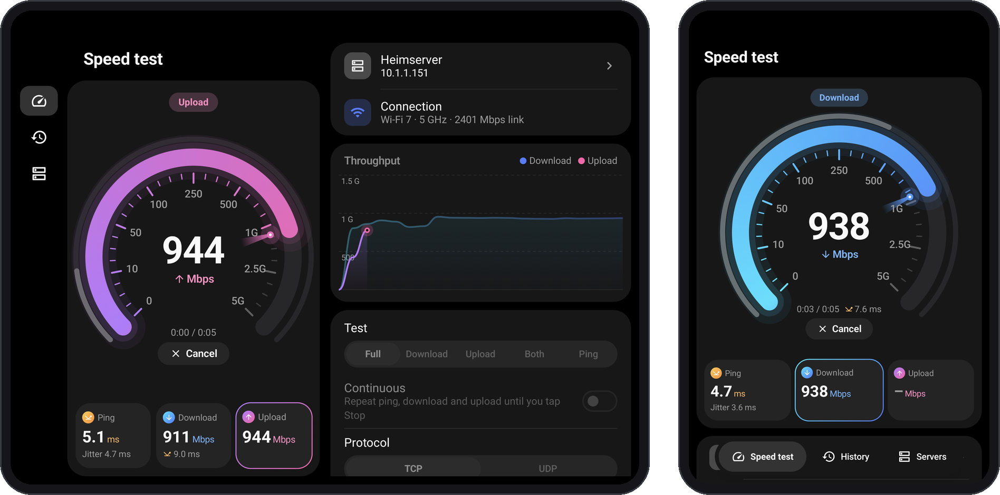
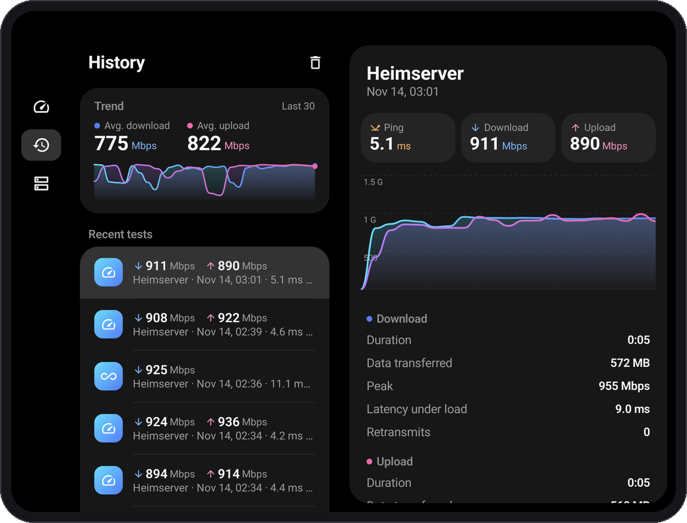
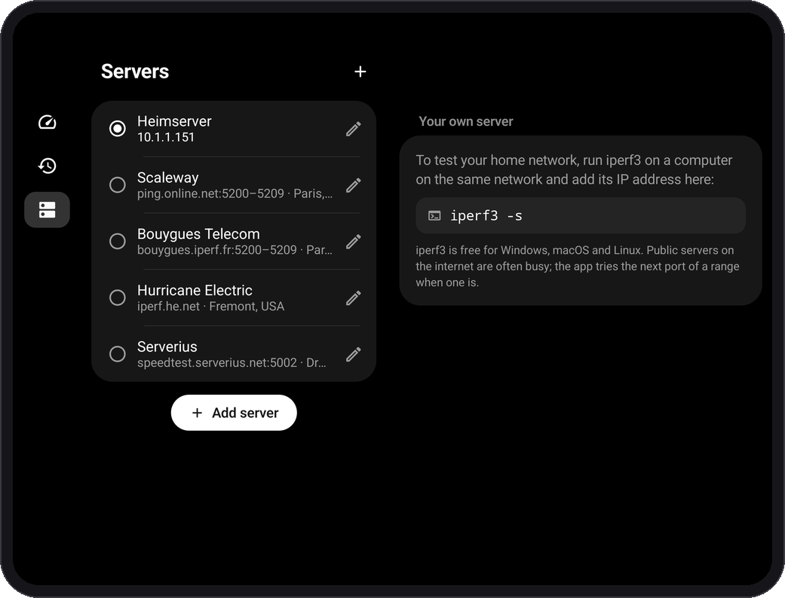
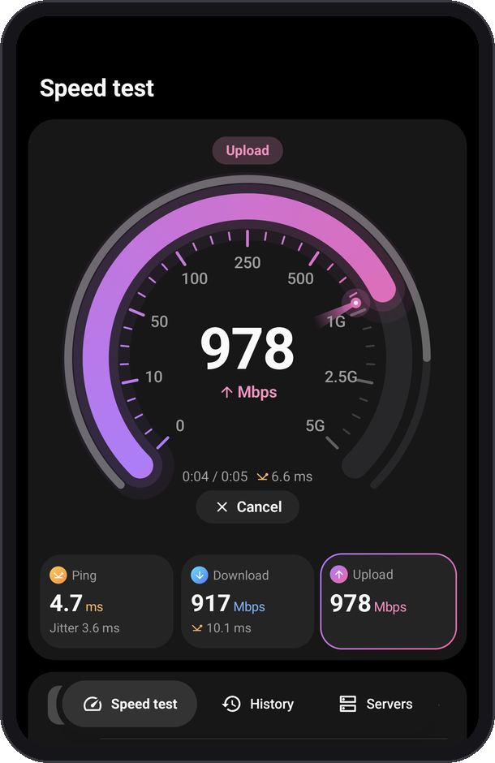
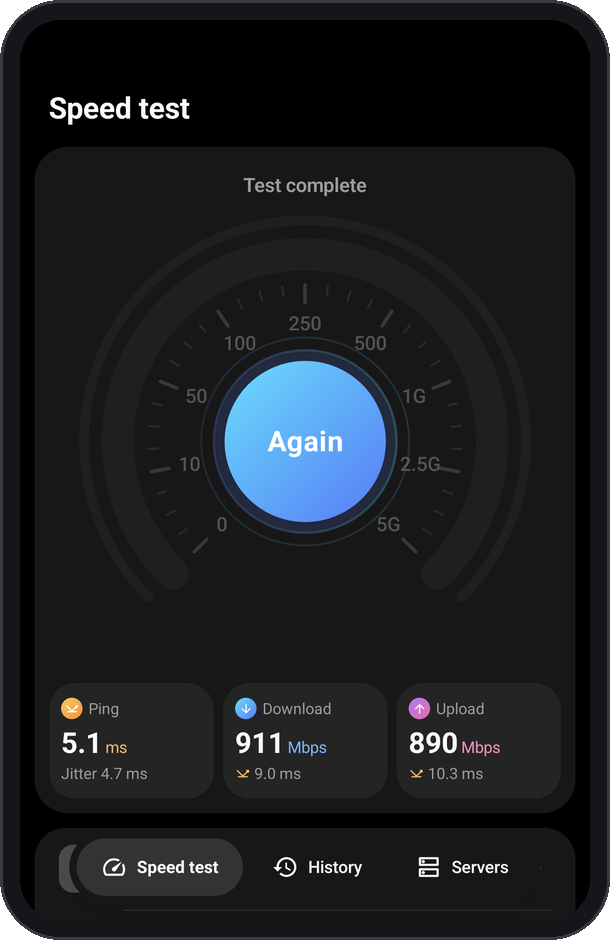
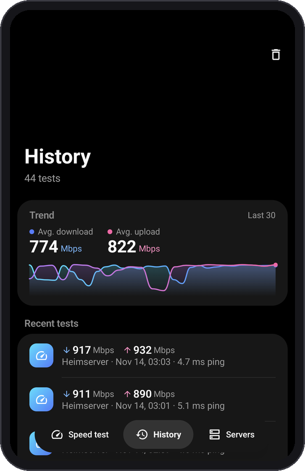

<div align="center">


# iPerfClient

**Measure your network with iperf3, on a dial that feels like a speed test app.**

iPerfClient is an [iperf3](https://github.com/esnet/iperf) client for Android, written in pure Kotlin. It's styled after Samsung One UI 9 and built for foldables like the Galaxy Z Fold8.

[](https://github.com/JustBuddy/iperfclient-android/releases/latest)


<br>



</div>

## ✨ Features

- **iperf3 in pure Kotlin.** The app speaks the iperf3 protocol itself, with no bundled binary: TCP and UDP, upload, download (reverse) and bidirectional tests, and 1–16 parallel streams. It works with any iperf3 server (3.x).
- **Test modes.** *Full* runs ping, download and upload in a row. *Download*, *Upload* and *Both* test one direction or both at once. *Ping* measures latency, jitter and packet loss on its own.
- **Continuous mode.** Keeps measuring until you tap Stop. Single-direction tests run as one open-ended iperf3 session (`-t 0`), so the measurement never drops out between rounds. Full mode repeats whole rounds. Useful for walking around to find weak Wi-Fi spots.
- **Speed-test dial.** A springy pointer, a gradient arc that switches to a multi-gigabit scale when needed, a latency scale for ping, and a live throughput chart.
- **Latency under load.** Ping keeps running during download and upload, so you can see how much the link's buffers add when it is busy.
- **History.** Every result is kept with its chart, retransmits, UDP jitter and loss, and the connection it ran over (Wi-Fi generation, band, link speed). A trend card shows your average speeds over the last 30 tests.
- **Servers.** Add your own server by IP or host name. Four public servers are included; their port ranges are tried in turn when one instance is busy.
- **Made for foldables.** The cover screen gets one pane with a floating tab bar. Unfolded, the dial and the controls sit on either side of the hinge. In tabletop posture the dial moves above the fold.
- **Light and dark.** The app follows the system theme and takes its accent colour from your colour palette.
- **English and German.**

## 📸 Screenshots

### Unfolded

| History with the result details | Servers |
|:---:|:---:|
|  |  |

### Folded (cover screen)

| Upload | Result | History |
|:---:|:---:|:---:|
|  |  |  |

<sub>The screenshots were taken on a Galaxy Z Fold8 over Wi-Fi 7, testing against an iperf3 server on the local network.</sub>

## 📥 Install

1. Download `iPerfClient-<version>.apk` from the [latest release](https://github.com/JustBuddy/iperfclient-android/releases/latest).
2. Open it on your phone. If Android asks, allow your browser or file manager to install apps.
3. Start iPerfClient, pick a server and tap *Start*.

You need Android 12 or newer. iPerfClient is built and tested on a Galaxy Z Fold8 with One UI 9, but it runs on any Android phone or tablet, and the layout adapts to the screen.

## 🖥️ Run your own server

Public servers are shared and often busy, and they measure your internet connection, not your home network. To test your Wi-Fi, start iperf3 on a computer in the same network:

```sh
iperf3 -s
```

Then add the computer's IP address under *Servers*. iperf3 is free for [Windows, macOS and Linux](https://iperf.fr/iperf-download.php).

## 🔑 Permissions

| Permission | What it's for |
|---|---|
| `INTERNET` | The iperf3 control and data connections |
| `ACCESS_LOCAL_NETWORK` ("Nearby devices") | Reaching servers on your own network. Android 17 blocks LAN connections without it; the app asks when you start a test against a LAN address. |
| `ACCESS_NETWORK_STATE`, `ACCESS_WIFI_STATE` | Showing the Wi-Fi generation, band and link speed |

## 🛠️ Build from source

You'll need the Android SDK (API 37) and JDK 17 or newer. Android Studio's bundled JBR works.

```sh
./gradlew assembleRelease        # app/build/outputs/apk/release/app-release.apk
./gradlew testDebugUnitTest      # unit tests
./gradlew lintDebug
adb install -r app/build/outputs/apk/release/app-release.apk
```

> [!TIP]
> Use the release build on a real phone. Debug builds run Compose unoptimised, so animations aren't smooth.

The engine tests can also run against a real server:

```sh
IPERF_SERVER=192.168.1.10 ./gradlew testDebugUnitTest            # TCP, UDP, bidirectional, back-to-back
IPERF_RANGE=ping.online.net:5200-5209 ./gradlew testDebugUnitTest # walks a public server's ports
```

<details>
<summary><b>Signing and publishing releases</b> (for maintainers)</summary>

### Signing

Release builds are signed with the key named in `keystore.properties` next to `settings.gradle.kts`. That file is gitignored.

```properties
storeFile=C:/Users/you/.android/iperfclient-release.jks
storePassword=…
keyAlias=iperfclient
keyPassword=…
```

CI reads the same values from `SIGNING_*` environment variables. If neither is set, release builds fall back to the debug key and Gradle prints a warning. Android won't install a debug-signed copy over a release-signed one, or the other way round. Keep a backup of the keystore, because updates only install over a copy signed with the same key.

### Releases

The version lives in `gradle.properties` (`iperfclient.version`), and the version code is derived from it. To publish a release:

1. Bump `iperfclient.version` and merge.
2. Tag the merge commit `v<version>` and push the tag, for example `git tag v0.2.0 && git push origin v0.2.0`.

The [Release APK](.github/workflows/release.yml) workflow runs the unit tests and lint, builds the signed APK and attaches `iPerfClient-<version>.apk` to a GitHub release for the tag. It fails if the tag and `iperfclient.version` don't match. Pull requests run the same build and keep the APK as a run artifact. Only the job that publishes the release can write to the repository.

The workflow needs these repository secrets: `SIGNING_KEYSTORE_BASE64` (the keystore, base64-encoded), `SIGNING_STORE_PASSWORD`, `SIGNING_KEY_ALIAS` and `SIGNING_KEY_PASSWORD`.

</details>

## 🧱 Built with

- [Kotlin](https://kotlinlang.org/) and [Jetpack Compose](https://developer.android.com/compose), with a custom One UI theme on top of Material 3
- Its own implementation of the [iperf3](https://github.com/esnet/iperf) protocol, over plain TCP and UDP sockets
- [AndroidX Window](https://developer.android.com/jetpack/androidx/releases/window) for the hinge and posture

---

<div align="center">
<sub>Created in <a href="https://t3.codes">T3 Code</a>.</sub>
</div>
